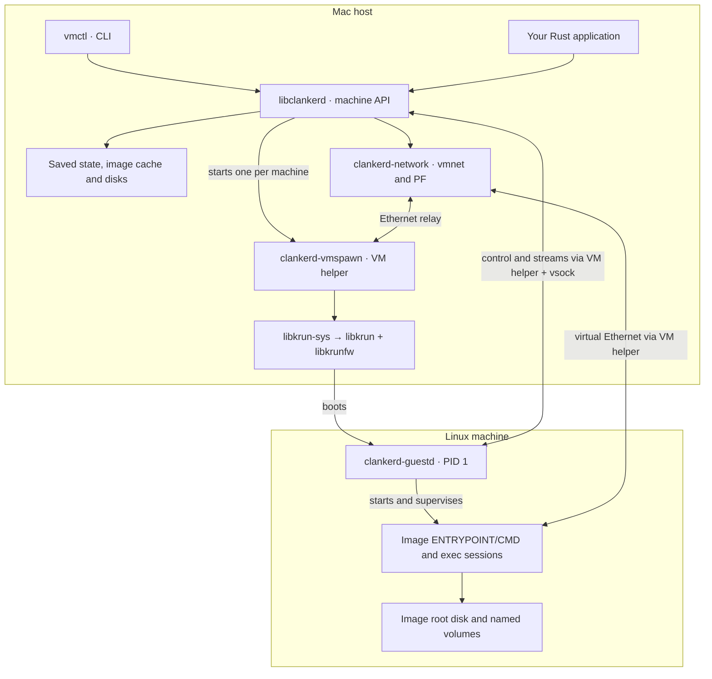

# clankerd

A Rust library and CLI for running Linux virtual machines from OCI container
images on Apple Silicon Macs. It uses libkrun and the stock libkrunfw kernel.
Each machine gets its own Linux kernel, image root filesystem and guest init
process. You can run commands, share Mac directories, attach persistent volumes
and connect machines through virtual networks.

## How it works



1. **Create:** the library pulls and caches the image, prepares a machine root
   disk and saves the configuration.
2. **Start:** the VM helper boots Linux. Guestd prepares mounts and networking,
   then starts the image's `ENTRYPOINT`/`CMD`. Its management environment is
   separate from the workload filesystem, so images need no clankerd tools.
3. **Use:** the CLI sends commands to guestd through a host Unix socket and
   vsock, a host-to-guest channel. `clankerd-proto` defines the shared messages
   and stream formats. The VM helper owns forwarding and survives CLI exit.
4. **Stop:** guestd shuts down the machine. Saved configuration, the machine
   disk and named volumes remain for the next start.

The image command can exit while the machine keeps running. `exec` still works;
`stop` or `kill` ends the machine. Restart policies apply to machine failure.
See [machine lifetime](docs/machine-lifecycle.md).

## Project structure

All Rust components live under `crates/`:

| Path | Responsibility |
| --- | --- |
| `crates/vmctl/` | CLI parsing, output and calls to the library |
| `crates/libclankerd/` | Public `Engine` and `Machine` APIs; lifecycle, images, disks, volumes, networks and exec |
| `crates/clankerd-vmspawn/` | Per-machine host process; boots libkrun, relays guest traffic and owns forwarding |
| `crates/clankerd-guestd/` | Linux PID 1; boot setup, workloads, exec sessions and shutdown |
| `crates/clankerd-proto/` | Host/guest messages, VM launch specifications and stream codecs |
| `crates/clankerd-network/` | Mac networking helper; Apple vmnet attachments and PF firewall rules |
| `crates/libkrun-sys/` | Rust bindings and boot configuration for libkrun |
| `build-support/` | Locked guest inputs, management filesystem files and build rules |
| `scripts/` | Build tooling, diagnostics and native smoke tests |
| `images/` | Docker image recipes and startup helpers for running Docker inside a machine |
| `docs/` | Build, lifecycle, networking and testing guides |

Within `libclankerd/src/`, start with `engine.rs` and `machine.rs` for lifecycle,
`images.rs` and `rootdisk.rs` for image preparation, `net/` for connectivity,
and `guest.rs` for guest communication. Each crate keeps its integration tests
in `tests/`.

## Build

Host executables require **native Apple Silicon macOS**, Python 3.12+, Apple's
command-line SDK, and installed libkrun, libkrunfw and liblzma libraries.
Install the pinned tools and build:

```sh
mise install
mise exec -- make build
```

For libraries installed with Homebrew, use `mise exec -- make build-homebrew`
to discover their linker and runtime paths. The regular build uses your existing
native library configuration.

The build downloads verified guest inputs, compiles and signs the executables,
and publishes `build/artifact/`. Keep the bundle together: `darwin-arm64/`
contains the host executables; `linux-arm64/management/` contains guestd and
its management filesystem. Host libraries must remain installed.
See [native build](docs/native-build.md) for setup and troubleshooting.

## Run a machine

```sh
vmctl=build/artifact/darwin-arm64/vmctl
"$vmctl" machine create --name sandbox debian:trixie
"$vmctl" machine start sandbox
"$vmctl" machine exec -it sandbox /bin/bash
# Exit the guest shell before continuing.
"$vmctl" machine stop sandbox
"$vmctl" machine start sandbox
"$vmctl" machine stop sandbox
"$vmctl" machine rm sandbox
```

`create` saves a machine without booting it. `start` boots it and runs the image
command once. `run` combines create and start, waits for the image command and
returns its exit code; `run -d` returns immediately. Both leave the machine
running. `exec -it` opens a separate interactive session.

### Share files and keep data

From the directory you want to share:

```sh
"$vmctl" run -d --name dev --cpus 2 --memory 2G \
  -v "$PWD:/workspace" -v data:/data debian:trixie
"$vmctl" exec -it dev /bin/bash
```

`-v /host/path:/guest/path` shares a Mac directory through virtio-fs.
`-v NAME:/guest/path` attaches a named Linux volume, creating it when needed.
Volumes survive machine removal and image changes; `vmctl volume rm NAME`
explicitly deletes their data.

Bind mounts default to simplified permissions: files appear owned by the guest
user, `chown` does not persist ownership, and `chmod` changes Mac permissions.
Use `--mount type=bind,source=./src,target=/src,semantics=complete` to preserve
Linux ownership and permissions in host extended attributes.

### Connect machines

```sh
"$vmctl" network create --mode shared team
"$vmctl" run -d --name worker --network team debian:trixie
"$vmctl" network inspect team
```

Machines on the same virtual network can communicate. Separate virtual networks
isolate peers. `shared` supplies Internet access; `host-only` supplies host and
peer access without built-in Internet access. Without `--network`, machines use
the default shared network. Use `--bridge-interface en0` instead to attach to a
physical LAN. Network setup uses ordinary sudo authentication; the VM runs as
your user. See [virtual networks](docs/virtual-networks.md).

Use `"$vmctl" --help` and `"$vmctl" run --help` for commands and flags.
Machine commands also have shortcuts: `vmctl create`, `vmctl exec`, and so on.
For scripts, `"$vmctl" machine ls --output json` returns structured output;
`"$vmctl" --describe-contract` exports command metadata and result schemas.

## Develop and test

Linux supports guest builds and developer tests; running VMs requires macOS.

```sh
mise exec -- make test lint
```

This runs the platform's Rust tests, Python build-tool tests, formatting and
Clippy checks. Linux needs liblzma development files and e2fsprogs; privileged
filesystem tests also need root, loop devices and mount permissions.
See [Rust testing](docs/rust-testing.md) for setup and coverage.

On a Mac, `mise exec -- make test-acceptance` builds and checks the signed bundle
and runs native VM gates. Use `test-acceptance-homebrew` with Homebrew libraries.
For workloads that need Docker or Compose, see
[Docker inside a machine](docs/docker-in-machine.md).
