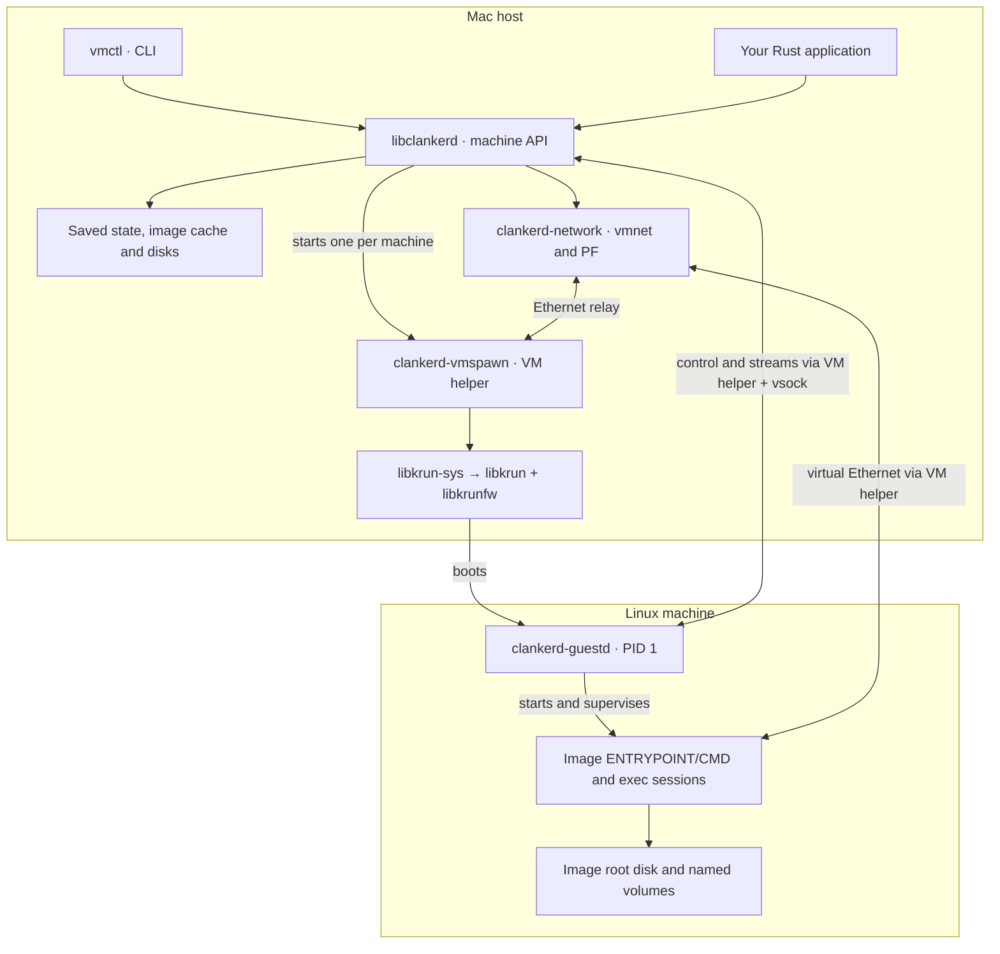

# clankerd

A Rust library and CLI for running Linux virtual machines from OCI container
images on Apple Silicon Macs. It uses libkrun and the stock libkrunfw kernel.
Each machine gets its own Linux kernel, image root filesystem and guest init
process. You can run commands, share Mac directories, attach persistent volumes
and connect machines through virtual networks.

## Build and install

Requires **Apple Silicon macOS** and Homebrew. From the repo root:

```sh
# Skip if Apple's command-line tools are installed.
xcode-select --install
brew install mise python@3.12 xz
brew tap slp/krun
brew trust slp/krun
brew install libkrun
mise install
mise exec -- cmake --preset homebrew
mise exec -- cmake --build --preset homebrew --target build
```

Stop development VMs before installing the **network helper**, the system LaunchDaemon required for networking. Installation prompts for administrator access; repeat after helper changes.

```sh
mise exec -- cmake --build --preset homebrew --target install-network-helper
mise exec -- cmake --build --preset homebrew --target verify-network-helper
mise exec -- cmake --build --preset homebrew --target status-network-helper
```

Keep `build/artifact/` together and Homebrew libraries installed. Host binaries
retain runtime paths to those installed libraries. For a non-Homebrew setup, use
the `default` preset and supply native linker and runtime library paths yourself.
Apple Silicon macOS, Python 3.12+, Apple's command-line SDK, libkrun, libkrunfw
and liblzma are required.

Restart or uninstall the shared network helper with `restart-network-helper` or
`uninstall-network-helper`, using the same CMake build preset. Both require
administrator access. Restarting, replacing, or crashing the helper interrupts
networking for every running machine using it; stop/start those machines to
restore networking. Required cleanup failure also terminates the helper.

## Run a machine

```sh
vmctl=build/artifact/darwin-arm64/vmctl
"$vmctl" machine create --name sandbox debian:trixie
"$vmctl" machine start sandbox
"$vmctl" machine exec -it sandbox /bin/bash
# Exit the guest shell before continuing.
"$vmctl" machine stop sandbox
"$vmctl" machine start sandbox
"$vmctl" machine stop sandbox
"$vmctl" machine rm sandbox
```

`create` saves a machine without booting it. `start` boots it and runs the image
command once. `run` combines create and start, waits for the image command and
returns its exit code; `run -d` returns immediately. Both leave the machine
running. `exec -it` opens a separate interactive session.

### Share files and keep data

From the directory you want to share:

```sh
"$vmctl" run -d --name dev --cpus 2 --memory 2G \
  -v "$PWD:/workspace" -v data:/data debian:trixie
"$vmctl" exec -it dev /bin/bash
```

`-v /host/path:/guest/path` shares a Mac directory through virtio-fs.
`-v NAME:/guest/path` attaches a named Linux volume, creating it when needed.
Volumes survive machine removal and image changes; `vmctl volume rm NAME`
explicitly deletes their data.

Bind mounts default to simplified permissions: files appear owned by the guest
user, `chown` does not persist ownership, and `chmod` changes Mac permissions.
Use `--mount type=bind,source=./src,target=/src,semantics=complete` to preserve
Linux ownership and permissions in host extended attributes.

### Connect machines

```sh
"$vmctl" network create --mode shared team
"$vmctl" run -d --name worker --network team debian:trixie
"$vmctl" network inspect team
```

Machines on the same virtual network can communicate. Separate virtual networks
isolate peers. `shared` supplies Internet access; `host-only` supplies host and
peer access without built-in Internet access. Without `--network`, machines use
the default shared network. Use `--bridge-interface en0` instead to attach to a
physical LAN. Network setup uses the installed root LaunchDaemon; the VM runs as
your user. Each machine belongs to one virtual network; change membership with
`vmctl update --network NAME MACHINE` while stopped. A network cannot be removed
while a saved machine belongs to it. Use a network with one member for individual
isolation. The Mac and its administrator are trusted; cross-network isolation
requires the host PF rules to retain the `com.apple/*` anchor and clankerd's rules.

Use `"$vmctl" --help` and `"$vmctl" run --help` for commands and flags.
Machine commands also have shortcuts: `vmctl create`, `vmctl exec`, and so on.
For scripts, `"$vmctl" machine ls --output json` returns structured output;
`"$vmctl" --describe-contract` exports command metadata and result schemas.

## How it works



1. **Create:** the library pulls and caches the image, prepares a machine root
   disk and saves the configuration.
2. **Start:** the VM helper boots Linux. Guestd prepares mounts and networking,
   then starts the image's `ENTRYPOINT`/`CMD`. Its management environment is
   separate from the workload filesystem, so images need no clankerd tools.
3. **Use:** the CLI sends commands to guestd through a host Unix socket and
   vsock, a host-to-guest channel. `clankerd-proto` defines the shared messages
   and stream formats. The VM helper owns forwarding and survives CLI exit.
4. **Stop:** guestd shuts down the machine. Saved configuration, the machine
   disk and named volumes remain for the next start.

The image command can exit while the machine keeps running. `exec` still works;
`stop` or `kill` ends the machine. Restart policies apply to machine failure.
An unexpected native machine exit can require manual restart when network
ownership cannot be confirmed, even with an automatic restart policy.

## Project structure

All Rust components live under `crates/`:

| Path | Responsibility |
| --- | --- |
| `crates/vmctl/` | CLI parsing, output and calls to the library |
| `crates/libclankerd/` | Public `Engine` and `Machine` APIs; lifecycle, images, disks, volumes, networks and exec |
| `crates/clankerd-vmspawn/` | Per-machine host process; boots libkrun, relays guest traffic and owns forwarding |
| `crates/clankerd-guestd/` | Linux PID 1; boot setup, workloads, exec sessions and shutdown |
| `crates/clankerd-proto/` | Host/guest messages, VM launch specifications and stream codecs |
| `crates/clankerd-network/` | Mac networking helper; Apple vmnet attachments and PF firewall rules |
| `crates/libkrun-sys/` | Rust bindings and boot configuration for libkrun |
| `cmake/` | Build graph and locked guest distribution inputs |
| `crates/clankerd-guestd/rootfs/` | Guest management filesystem policy |
| `tests/support/` | Shared test support files |
| `cmake/tests/` | Build-contract tests |
| `images/` | Docker image recipes and startup helpers for running Docker inside a machine |
| `docs/` | Agent conventions and architectural decisions |

Within `libclankerd/src/`, start with `engine.rs` and `machine.rs` for lifecycle,
`images.rs` and `rootdisk.rs` for image preparation, `net/` for connectivity,
and `guest.rs` for guest communication. Each crate keeps its integration tests
in `tests/`.

## Develop and test

Linux supports guest builds and developer tests; running VMs requires macOS.

```sh
mise exec -- cmake --preset default
mise exec -- cmake --build --preset default --target test lint
```

This runs the platform's Rust tests, Python build-tool tests, formatting and
Clippy checks. C formatting uses the clang-format version pinned in `mise.toml`
(installed with `mise install`). To format the C sources and headers, run:

```sh
mise exec -- cmake --build --preset default --target format-c
```

`lint-c-format` checks C formatting without modifying files and is included in
`lint` on Linux and macOS. Linux needs liblzma development files and e2fsprogs; privileged
filesystem tests also need root, loop devices and mount permissions.
For Linux coverage, run the `coverage` CMake target. Reports are written to
`build/coverage/coverage.json` and `build/coverage/html/index.html`. This excludes
macOS-only paths; unprivileged runs also omit mounted-filesystem tests.

On a Mac, build the signed bundle and run `test-native` for bind semantics or
`verify-host-lifecycle` for lifecycle assertions through CMake. See the
[verification skill](.agents/skills/verify-clankerd/SKILL.md) for prerequisites and evidence.
For workloads that need Docker or Compose, see
[the DinD image instructions](images/dind/README.md).
